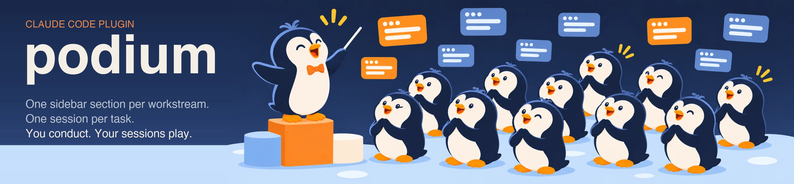

# podium

[English](README.md)

<p align="center">
  
</p>

**상태: 작성을 마쳤고, 프로젝트 설정·새 업무·현황·종료는 실제 세션에서 시험했습니다. 분할, 긴 세션 교체, 세션 정리는 아직 시험하지 못했습니다. 버전 0.1.0.**

## 이게 뭔가요?

podium은 Claude Code 세션이 한 줄로 쌓이는 것을 막아 주는 플러그인입니다.
하고 싶은 일을 평소 말투로 Claude에게 말하면, podium이 그 일을 업무 하나로 만듭니다. 사이드바 구역 하나, 지금 상황을 담은 파일 하나, 대표 세션 하나입니다. 업무가 커지면 대표 세션이 작업 세션을 거느리고, 작으면 세션 하나로 끝냅니다.
상태는 대화가 아니라 파일에 있어서, 어떤 세션을 닫아도 새 세션이 멈춘 곳에서 이어받습니다.

<p align="center">
  
</p>

## 누구를 위한 건가요?

- Claude Code를 주로 데스크톱 앱에서 쓰고, 한 번에 여러 일을 하며, 사이드바가 비슷한 제목의 긴 목록이 된 분
- 일이 코드만이 아닌 분. 예시에 코딩이 아닌 업무(이사 준비)도 있습니다.
- 직접 운전하고 싶은 분. podium은 무언가를 만들거나 옮기기 전에 먼저 묻습니다.

한 번에 일 하나만 하거나, 에이전트가 알아서 돌기를 원한다면 맞지 않습니다. 그런 도구는 따로 있고, podium은 반대로 사람이 운영합니다.

## 처음 5분

1. 아래 방법으로 설치합니다.
2. 프로젝트에서 "podium 설정하고 세션 정리해 줘"라고 말합니다. podium이 세션과 문서를 읽고 묶는 방법을 보여 준 뒤 "진행 / 수정 / 파일과 규칙만 설치"를 묻습니다.
3. 여러 세션에 걸칠 일이 생기면 Claude에게 업무로 만들라고 말합니다. 예: "이걸 새 업무로 만들어 줘: 할 일 앱에 알림 기능 붙이기." 잊어버려도 큰 일이 보이면 Claude가 한 번 제안합니다. podium이 알려 준 자료를 읽고, 최대 세 가지를 묻고, 계획(구역 이름, 대표 세션, 나중에 추가할 수 있는 작업 세션)을 보여 준 뒤 "진행 / 수정 / 작게 시작"을 묻습니다. 작은 일은 평소 대화로 처리하고 podium이 필요 없습니다.
4. 만들어진 대표 세션에서 일합니다. 작업 세션은 나누는 이득이 있을 때만 대표 세션 안에서 요청합니다.
5. 일이 끝나면 끝났다고 말합니다. podium이 파일을 확인한 뒤에 세션을 보관합니다.

## 설치

터미널에서:

```bash
claude plugin marketplace add stlahxm/podium
claude plugin install podium@podium
```

한 세션에서만 써 보려면 저장소를 복제한 뒤 `claude --plugin-dir ./podium`을 씁니다.
데스크톱 앱에서는 마켓플레이스를 추가한 뒤 프롬프트 옆 **+** 버튼에서 **Add plugins**를 고릅니다.

## 들어 있는 것

- 스킬 `podium` 하나와 그 안의 절차 아홉 개: 프로젝트 설정, 업무 시작, 현황, 분할·승격, 종료, 끝난 세션 한번에 정리, 지난 결정 찾기, 별도 세션으로 끝난 일 검증, 긴 세션 교체. 외울 명령은 없고 "이걸 새 업무로 만들어 줘", "지금 상황 어때?", "이 업무 닫아 줘", "끝난 세션 정리해 줘", "캐시 방식은 어디서 정했더라?" 같은 평소 문장으로 요청합니다.
- 맥락을 담는 파일 템플릿(`memory-bank/`)과 프로젝트 모든 세션이 podium의 존재를 알게 하는 짧은 `CLAUDE.md` 규칙 절(영어 기준 약 370단어: 역할, 나누기, 파일 담당, 보고와 승인)(영어, 한국어). 전체 규칙은 [docs/rules.ko.md](docs/rules.ko.md)에 있습니다
- 공용 도구 세션(읽기 전용 데이터 조회 등)의 규칙 템플릿(`templates/ko/tool-session.md`)
- `examples/`의 가상 예시 둘: 소프트웨어 기능 하나와 이사

## 비용은 어떻게 낮추나

매 턴 컨텍스트에 들어가는 것은 스킬의 한 줄 설명뿐입니다. 절차와 템플릿은 필요할 때만 읽습니다. 이 한 줄도 싫다면 수동 모드를 켭니다. `skills/podium/SKILL.md`의 머리말에 `disable-model-invocation: true`를 추가하고, 필요할 때 `/podium`으로 부릅니다.

## 설정

`memory-bank/.podium.json`: `idPrefix`(기본 `W`), `ledgerPath`(기본 `memory-bank/sessions.md`), `maxWorkSessions`(기본 4). [docs/config.md](docs/config.md)를 보세요.

## 한계

- 세션을 만들고 사이드바 구역에 넣는 일은 데스크톱 앱의 세션 도구를 씁니다. 일반 터미널에서는 파일과 규칙은 설치해 주고 붙여 넣을 브리프를 만들어 주지만, 세션은 직접 열어야 합니다.
- 세션은 그 세션에서 사용자가 직접 요청해야 새 세션을 열 수 있고, 떼어 내기는 연 세션만 할 수 있습니다. podium은 업무마다 대표 세션을 먼저 열고, 나누는 일은 그 안에서 하게 하는 방식으로 이를 피합니다.
- podium은 세션이 일을 어떻게 하는지(코딩 방식, 테스트, 글쓰기)는 정하지 않습니다. 그런 규칙은 각자의 `CLAUDE.md`에 두세요.
- 실제 세션에서 확인한 것([docs/design-notes.md](docs/design-notes.md) 참고): 스킬이 맞는 절차만 읽고, 작은 질문에는 조용하고, 답을 기다리며, 사용자가 직접 입력했을 때 대표 세션을 열고 구역에 넣을 수 있습니다. 아직 확인하지 못한 것: 분할, 긴 세션 교체, 세션 정리, 세션이 이미 많은 프로젝트.

## 비슷한 프로젝트

Gas Town과 CCPM은 코딩 에이전트를 자동으로 조율하고, claude-workstream-kit은 프로젝트 하나의 업무 상태를 파일로 관리합니다. podium은 여러 종류의 일에 걸쳐 많은 세션을 운영하는 사람을 위한 것입니다. 자세한 내용과 출처는 [docs/design-notes.md](docs/design-notes.md)에 있습니다.

## 라이선스

MIT
